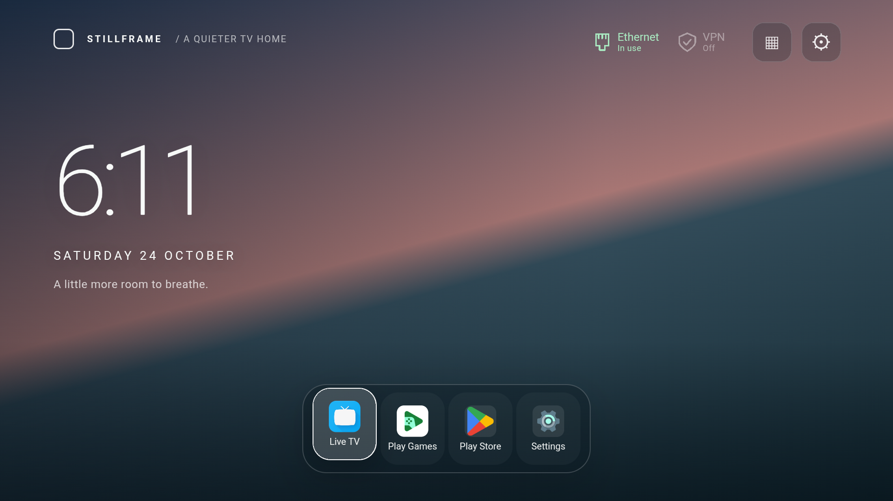
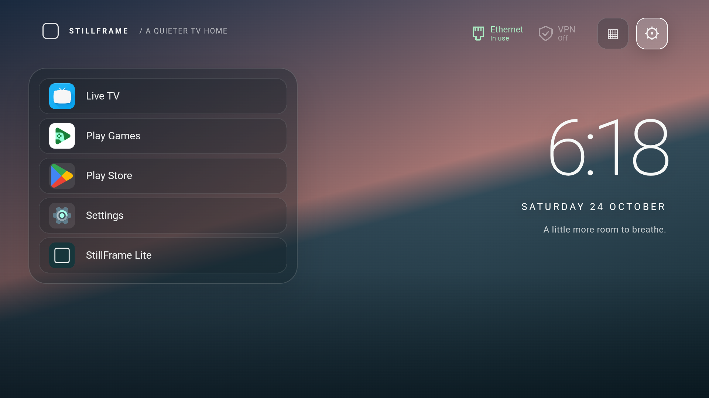

# StillFrame TV

A calm Android TV Home launcher with a clock, favourite apps, configurable layouts and remote-first settings. Projectivy Launcher is not required.

<a href="https://buymeacoffee.com/shiftylabs"></a>

*Enjoying StillFrame? Coffee support is optional, and downloads remain free.*





*Actual Android TV emulator screenshots, showing the dock and list-left layouts with an original StillFrame gradient.*

One project builds two editions:

| Feature | Full | Lite |
|---|:---:|:---:|
| Dock, list left and list right layouts | ✓ | ✓ |
| Clock, date, network and VPN indicators | ✓ | ✓ |
| Favourites, rearranging and app visibility | ✓ | ✓ |
| Android icon packs and per-app icon selection | ✓ | ✓ |
| Brand-coloured focus glow (optional) | ✓ | ✓ |
| Gradient backgrounds and imported photos | ✓ | ✓ |
| Optional nature photo downloads (saved offline) | ✓ | ✓ |
| Selectable VPN widget controls (Proton tested) | ✓ | ✓ |
| Local video wallpapers | ✓ | — |
| Overflight / API-v1 video providers | ✓ | — |

Lite excludes the native video implementation, plugin API and Apple video trust configuration. Full also releases its video decoder when using photos; Lite should not be treated as a guaranteed large RAM saving.

## Download and install

Download one APK from the [latest release](https://github.com/Shifty-labs/stillframe-tv/releases/latest):

- **[Download Lite](https://github.com/Shifty-labs/stillframe-tv/releases/download/v0.29.0/stillframe-lite-0.29.0.apk)** — photos, gradients and icon packs; no video wallpaper plugins.
- **[Download Full](https://github.com/Shifty-labs/stillframe-tv/releases/download/v0.29.0/stillframe-full-0.29.0.apk)** — includes local video wallpapers and compatible Overflight providers.

For Android TV / Google TV running Android 8.0 or newer; not Samsung Tizen or LG webOS. No source-code build is needed. Transfer the APK to your TV with USB or a file-transfer app, open it in a file manager, and allow that app to install unknown apps if prompted. You can revoke that permission afterwards. Alternatively install over ADB; see [step-by-step setup](docs/SETUP.md).

Open StillFrame and test app launching and your remote before making it Home. Keep the original TV launcher installed for recovery. Full's third-party wallpaper plugin and videos are separate downloads.

**Earlier development installs:** these releases use a new private release key and cannot update debug-signed builds in place. Do not uninstall your working Home launcher without a fallback; uninstalling also removes settings. Your existing installation can continue working. Future public releases will use the same release key for in-place updates.

## Optional family wallpaper pack

[Download Family Adventures — four wallpapers](https://github.com/Shifty-labs/stillframe-tv/releases/download/v0.29.0/stillframe-family-adventures-v1.zip): Roblox-inspired Rainbow Adventure, Minecraft-inspired Cherry Adventure, 99 Nights-inspired Cozy Forest and Fortnite-inspired Island Adventure. Unofficial AI-generated fan art, supplied separately from the app. Unzip and import the JPGs through **Settings → Appearance → Wallpaper gallery** using a compatible TV file picker. Works offline in Full and Lite. Game names and characters belong to their respective owners; no endorsement is implied.

## Status

Experimental development version **0.29.0**. The preceding Full implementation was tested on NVIDIA Shield with Android 11. Full and Lite have launched in an Android TV emulator. Lite 0.26 was also tested on a Sharp AQUOS running Android 14, including app launch, Home and user-reported standby/wake. The release-signed packages need wider device testing.

The shareable source includes original CSS gradients instead of the personal installation's stock-photo collection. Use **Appearance → Download nature wallpapers** for three optional licensed photos, or import your own images through Appearance → Wallpaper gallery. Photos download only when requested and work offline afterwards. Both editions now request Internet permission; Lite still contains no video or Overflight implementation. See [nature photo credits](docs/NATURE-WALLPAPERS.md). Third-party icon packs, plugin APKs, aerial videos and account data are not bundled.

## Build

Use JDK 21 and Android SDK Platform 35. Set `ANDROID_HOME`, or create an untracked `local.properties` containing `sdk.dir=/path/to/sdk`.

```sh
./gradlew :app:assembleFullDebug :app:assembleLiteDebug
```

Outputs:

- `app/build/outputs/apk/full/debug/app-full-debug.apk`
- `app/build/outputs/apk/lite/debug/app-lite-debug.apk`

Full uses `dev.stillframe.tv`; Lite uses `dev.stillframe.tv.lite`. Both can be installed together, with independent settings. Updates require the same signing key. CI debug artifacts are for testing, not a stable release-signing identity.

## Install

```sh
adb install -r app/build/outputs/apk/full/debug/app-full-debug.apk
# Or:
adb install -r app/build/outputs/apk/lite/debug/app-lite-debug.apk
```

Test app launching and remote controls before choosing StillFrame as Home. Keep a working stock launcher installed. StillFrame does not disable or uninstall system apps or other launchers.

## Controls

- D-pad moves selection; OK activates it.
- Hold OK on an app for Move icon / Change appearance. Back cancels moving.
- Home closes StillFrame menus.
- Play/Pause manages favourites where indicated.
- Settings → Appearance contains layout, wallpaper and icon controls.
- **Appearance → Layout width / Layout height** sizes the bottom dock and both side lists. **Outer frame** hides or shows the surrounding panel while keeping app tiles and focus glow.
- Select the active Wi-Fi or Ethernet icon to see connection details and open Android network settings.
- Settings uses grouped appearance controls and a remote-friendly card layout.
- Full retains video continuity on brief Home presses and uses the last video frame while resuming from other apps.
- **Appearance → App brand glow** turns the coloured focus rim and halo on or off. Known apps use curated brand colours; other apps use a cached colour sample from their original Android icon, or neutral white if no suitable colour is found. Applies to dock, both list layouts and All Apps; icon packs do not override known brand colours. Reordering keeps its separate gold highlight.
- First use of VPN controls explains widget permission. Continue opens Android approval where available, or one-time ADB instructions on TVs without that screen.

See [setup and recovery](docs/SETUP.md), [wallpapers](docs/WALLPAPERS.md), [Proton VPN](docs/PROTON-VPN.md), [development](docs/DEVELOPMENT.md), [laptop preview](docs/LAPTOP-PREVIEW.md), and [known limitations](docs/KNOWN-ISSUES.md).

## Support StillFrame

<a href="https://buymeacoffee.com/shiftylabs"></a>

If you enjoy StillFrame, you can [buy Shifty Labs a coffee](https://buymeacoffee.com/shiftylabs) to support continued development. Support is entirely optional; the APK downloads remain free. Thank you for trying it.

## Licensing

An open-source license for the original StillFrame code has not yet been selected. Repository visibility alone does not grant reuse rights. Third-party API notices and their Apache-2.0 license remain included in Full; see [notices](NOTICE.md).
